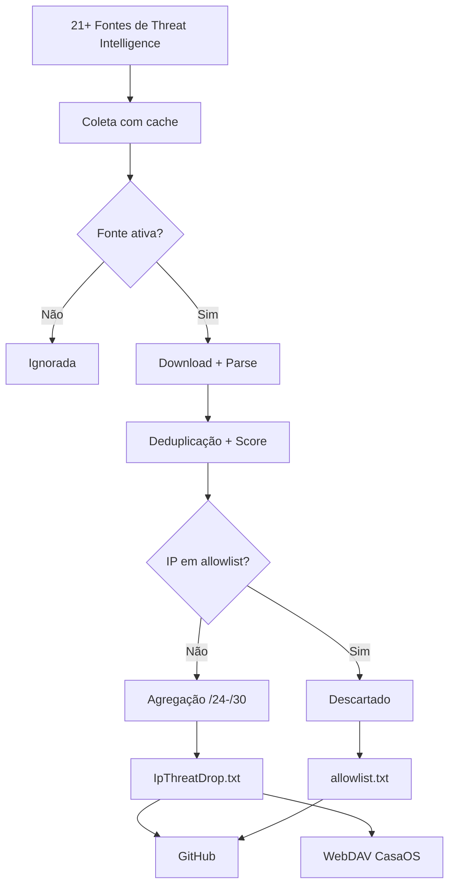

# 🛡️ IpThreatDrop - Blocklist Unificada

<p align="center">
  
  
  
  
  
</p>

## 📋 Descrição

**IpThreatDrop** é a **Blocklist Unificada** — uma lista de IPs e blocos CIDR maliciosos atualizada automaticamente a partir de **múltiplas fontes** de threat intelligence (Spamhaus DROP, Abuse.ch, SERPRO, ThreatFox, CrowdSec, AbuseIPDB, NRA, CPS, Bitwire, CINS, DShield, GreenSnow, SpydiSec, C2IntelFeeds, IPsum, entre outras).

Os dados são gerados por um **script PowerShell v3.15.8** que faz:

- 🔒 Coleta de **21+ fontes ativas** (Sources + CacheSources + AuthSources)
- 🛡️ Aplica **allowlist de 18 fontes** (16 corporativas + antivírus)
- 🧹 **Deduplicação inteligente** com agregação dinâmica (`/24` a `/30`)
- 📊 **Score de ameaça** por concordância entre fontes
- 🚀 Publicação em `IpThreatDrop.txt` e `allowlist.txt`
- ☁️ Envio para **WebDAV CasaOS** com verificação de SHA-256

---

## 🔒 O Que é a Allowlist?

A allowlist é um conjunto de IPs e CIDRs que **nunca serão bloqueados**, mesmo que apareçam nas fontes de threat intelligence. Isso garante que serviços essenciais continuem funcionando sem interrupção.

### ✅ Serviços na Allowlist (16 fontes corporativas)

| Empresa / Serviço | Serviços | Importância |
|-------------------|----------|-------------|
| **Google** | GCP, Workspace, 8.8.8.8 | DNS, e-mail, pesquisas |
| **Amazon AWS** | EC2, S3, CloudFront | Hospedagem em nuvem |
| **Microsoft Azure** | Azure, Office 365, Teams | Serviços corporativos |
| **Cloudflare** | CDN, DNS, DDoS Protection | Proteção de sites |
| **Oracle Cloud** | OCI, Autonomous DB | Banco de dados em nuvem |
| **Fastly** | CDN, Edge Compute | Distribuição de conteúdo |
| **Akamai** | CDN, WAF, Anti-DDoS | Distribuição global |
| **GitHub** | Pages, API, Actions, Git | DevOps |
| **Zoom** | Reuniões, Webinars | Videoconferência |
| **Datadog** | APM, Logs, Métricas | Observabilidade |
| **Pingdom** | Monitoramento sintético | Uptime |
| **UptimeRobot** | Monitoramento | Uptime |
| **Imperva** | WAF, DDoS | Segurança |
| **Stripe** | Webhooks, API | Pagamentos |
| **Antivírus (fixo)** | Bitdefender, ESET, Kaspersky | Endpoint Protection |

### 🎯 Exemplo Prático

**Cenário 1:** O IP `8.8.8.8` (Google DNS) aparece em uma lista de IPs maliciosos.

- ❌ **Sem allowlist:** o IP seria bloqueado, e você perderia acesso ao DNS do Google
- ✅ **Com allowlist:** o IP é removido automaticamente da blocklist, mantendo seu DNS funcionando

**Cenário 2:** O IP `34.98.103.74` (Google Cloud, hospedando um serviço interno) aparece em uma blocklist.

- ❌ **Sem allowlist:** o IP seria bloqueado
- ✅ **Com allowlist:** o IP é removido porque a faixa `34.98.64.0/18` (Google Cloud) está coberta

### 🛡️ Como Funciona

1. **Coleta** — o script baixa as fontes de threat intelligence (com cache local 12-24h)
2. **Allowlist** — os CIDRs das 18 allowlists são consolidados em redes `/24` protegidas
3. **Filtragem** — IPs/CIDRs que caem em faixa protegida são **descartados antes** de entrar no pipeline
4. **Agregação** — os IPs restantes são agrupados por `/24` e recebem a menor máscara possível (`/24` a `/30`)
5. **Score** — cada entrada recebe um score baseado no peso das fontes que a listaram
6. **Publicação** — ordenado por score, corte em `MaxLinhasArquivo` (300k), gravação atômica + SHA-256
7. **Envio** — WebDAV CasaOS com verificação pós-envio

---

## 📊 Fluxo de Processamento



## 📦 Lista Completa de Fontes (25)

Os IPs e CIDRs são marcados com a origem no arquivo:

|1|- |**spamhaus-drop: Spamhaus DROP|
|2|-  |**blocklist.brute: blocklist.de (bruteforce)|
|3|-  |**binarydefense: Binary Defense|
|4|-  |**opendbl-tor: OpenDBL tor-exit|
|5|-  |**ipsum-github: IPsum (stamparm)|
|6|-  |**netlas: Netlas|
|7|-  ||**nra-osint: NRA OSINT|
||8|-  |**nra-sentinel-critical: NRA High Critical|
||9|-  |**abuseipdb-borestad: AbuseIPDB (Borestad)|
|10|- |**cps-avanzato-c2: CriticalPath Security (Avanzato)|
|11|- |**cps-collected-iocs: CriticalPath Security (Collected IOCs)|
|12|- |**bitwire-outbound: Bitwire Outbound|
|13|- |**cins: CINS Score|
|14|- ||**public-xlogic: Public Xlogic|
|15|- |**ipinsights: IP Insights|
|16|- |**dshield: DShield|
|17|- |**serpro: SERPRO Blocklist|
|18|- |**threatfox: ThreatFox (abuse.ch)|
|19|- |**greensnow: GreenSnow|
|20|- |**spydisec: SpydiSec|
|21|- |**c2intel-30d: C2IntelFeeds|
|22|- |**crowdsec-1 / crowdsec-2 / crowdsec-3: CrowdSec|
|23|- |**abuseipdb: AbuseIPDB (API)|

## 🚀 Como Usar

**Em firewalls (Fortigate/pfSense/OPNsense)**

```
URL: https://raw.githubusercontent.com/marciosx/IpThreatDrop/main/IpThreatDrop.txt
```

**Em MikroTik RouterOS**

```
/tool fetch url="https://raw.githubusercontent.com/marciosx/IpThreatDrop/main/IpThreatDrop.txt" dst-path=blocklist.txt
/import file=blocklist.txt
```

**Em iptables**

```bash
curl -s https://raw.githubusercontent.com/marciosx/IpThreatDrop/main/IpThreatDrop.txt | \
    grep -E '^[0-9]' | \
    while read ip; do
        iptables -A INPUT -s $ip -j DROP
    done
```
**Em Python**

```python
import requests

url = "https://raw.githubusercontent.com/marciosx/IpThreatDrop/main/IpThreatDrop.txt"
response = requests.get(url)
ips = [line.split('#')[0].strip() for line in response.text.splitlines()
       if line and not line.startswith('#')]
```

**Em PowerShell**

```powershell
$url = "https://raw.githubusercontent.com/marciosx/IpThreatDrop/main/IpThreatDrop.txt"
$ips = Invoke-WebRequest -Uri $url |
    Select-Object -ExpandProperty Content |
    Where-Object { $_ -notmatch '^#' -and $_ -match '^[0-9]' }
```

### 🔄 Frequência de Atualização

Automática: a cada 12 horas via CRON.

### 📝 Formato do Arquivo

```
<IP ou CIDR> # score=<N> <origem1,origem2,...>

IPs individuais (não agregados)
66.132.172.5 # score=4.0 binarydefense
66.132.172.100 # score=5.0 threatfox
66.132.172.200 # score=7.5 serpro,blocklist.brute,cins

Sub-redes agregadas com máscaras dinâmicas
66.132.186.0/24 # score=12.0 subnet-agregado(188_IPs) binarydefense,cins,threatfox,serpro
66.132.195.0/26 # score=8.0 subnet-agregado(45_IPs) opendbl-tor,serpro
66.132.200.0/30 # score=9.5 subnet-agregado(4_IPs) threatfox,cps-avanzato-c2
66.132.210.32/29 # score=10.0 subnet-agregado(6_IPs) OTX_HoneyAI_Network_Services_Attack_Feed,cps-avanzato-c2
```

### 🔧 Como os Dados São Coletados

Os dados são gerados automaticamente por um script PowerShell v3.15.8 que unifica todas as fontes.

**Script:** Blocklist Unifier

[](https://opensource.org/licenses/MIT)
[](https://microsoft.com/powershell)
[](CHANGELOG.md)


### ✨ Características do Script

-🔒 21+ fontes ativas (Sources + CacheSources + AuthSources)

🚀 Coleta com timeout e retry automático (3 tentativas com b-ackoff)

-🧹 Deduplicação inteligente com agregação de sub-redes /24 a /30

-📊 Score de ameaça por concordância entre fontes

-🛡️ Allowlist de 18 fontes (16 corporativas + antivírus)

-🕐 Cache local de 12-24h para fontes lentas

-📝 Logs rotativos (manhã/tarde) com retenção configurável

-🔐 Auto-recuperação do config.json via config.json.bak

-☁️ Envio WebDAV com verificação pós-envio por SHA-256

### 🛡️ Segurança

Esta lista é fornecida "como está", sem garantias de qualquer tipo. Recomenda-se:

-✅ TLS 1.2 + 1.3 (fallback automático para schannel do Windows)

-✅ Instância única via mutex global (evita execuções concorrentes)

-✅ Anti-envenenamento de feed (descarta CIDRs maiores que /16, exceto exceções)

-✅ Validação final de formato antes de publicar

-✅ Gravação atômica (temp + move)

-✅ SHA-256 do arquivo gerado

-✅ Verificação pós-envio no WebDAV (SHA-256 remoto confere)

-✅ Auto-recuperação do config.json via config.json.bak

-✅ Auditoria de ACL dos arquivos de credencial

-✅ Códigos de saída para Zabbix / Task Scheduler

O uso desta lista é de inteira responsabilidade do usuário.

### ⚠️ Aviso
Esta lista é fornecida "como está", sem garantias de qualquer tipo. Recomenda-se:

-✅ Testar antes de usar em produção

-✅ Manter backups regulares

-✅ Verificar periodicamente a precisão dos dados

-✅ Monitorar falsos positivos

-✅ Ter um plano de contingência

O uso desta lista é de inteira responsabilidade do usuário
### 📜 Licença

MIT License

Copyright (c) 2026 marciosx

Permission is hereby granted, free of charge, to any person obtaining a copy
of this software and associated documentation files (the "Software"), to deal
in the Software without restriction, including without limitation the rights
to use, copy, modify, merge, publish, distribute, sublicense, and/or sell
copies of the Software, and to permit persons to whom the Software is
furnished to do so, subject to the following conditions:

The above copyright notice and this permission notice shall be included in all
copies or substantial portions of the Software.

THE SOFTWARE IS PROVIDED "AS IS", WITHOUT WARRANTY OF ANY KIND, EXPRESS OR
IMPLIED, INCLUDING BUT NOT LIMITED TO THE WARRANTIES OF MERCHANTABILITY,
FITNESS FOR A PARTICULAR PURPOSE AND NONINFRINGEMENT. IN NO EVENT SHALL THE
AUTHORS OR COPYRIGHT HOLDERS BE LIABLE FOR ANY CLAIM, DAMAGES OR OTHER
LIABILITY, WHETHER IN AN ACTION OF CONTRACT, TORT OR OTHERWISE, ARISING FROM,
OUT OF OR IN CONNECTION WITH THE SOFTWARE OR THE USE OR OTHER DEALINGS IN THE
SOFTWARE.

MIT License - Copyright (c) 2026 marciosx

## 📧 Contato

- Issues: GitHub Issues
- Email: marciosx@gmail.com

## 🎯 Download


### Arquivo completo
```bash
# Allowlist (serviços críticos)
wget https://raw.githubusercontent.com/marciosx/IpThreatDrop/main/IpThreatDrop.txt
curl -O https://raw.githubusercontent.com/marciosx/IpThreatDrop/main/IpThreatDrop.txt

# Blocklist completa (última versão)
wget https://raw.githubusercontent.com/marciosx/IpThreatDrop/main/IpThreatDrop.txt
curl -O https://raw.githubusercontent.com/marciosx/IpThreatDrop/main/IpThreatDrop.txt

```
